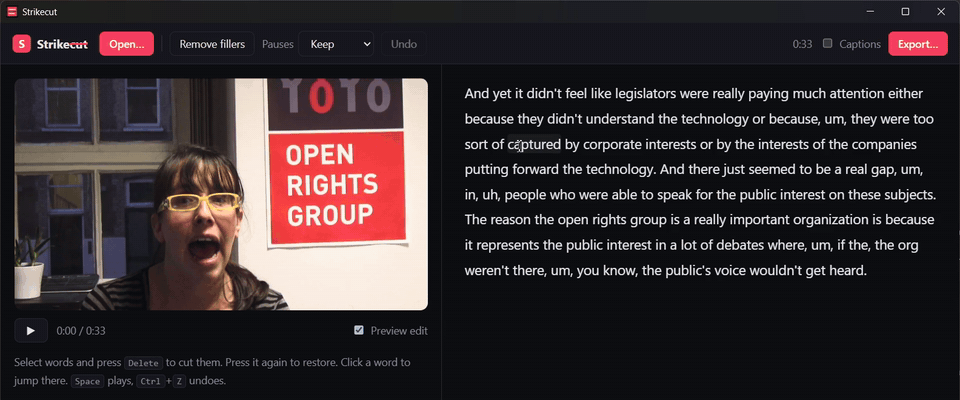

<div align="center">

# Strike~~cut~~

**Edit video by editing text.** Delete a word from the transcript and it's cut from the video.

Local. Open source. No account, no subscription, nothing uploaded.



<sub>Real, unscripted interview. One click strikes every um and uh, a sentence goes with <kbd>Delete</kbd>, and playback skips what's struck.</sub>

</div>

---

Strikecut is a free, open-source alternative to Descript's text-based editing, built in Rust as a single small app for Windows, macOS, and Linux. Speech is transcribed **on your machine** with [whisper.cpp](https://github.com/ggerganov/whisper.cpp), so your recordings never leave it.

## Features

- **Edit the transcript, cut the video.** Select words, press <kbd>Delete</kbd>. Press it again to restore.
- **Remove filler words in one click.** Um, uh, hmm... gone everywhere.
- **Shorten long pauses.** Cap every silence at 1.0s, 0.6s, or 0.3s.
- **Live preview.** Playback skips cut parts, so you hear the edit before exporting.
- **Frame-accurate export.** One streaming ffmpeg pass, with audio and video kept in sync across hundreds of cuts.
- **Captions for free.** Export `.srt` subtitles timed to the *edited* video.
- **A CLI built for scripts and AI agents.** Every edit is a command, and projects are plain JSON.

## The CLI

```sh
# One shot: transcribe, drop filler words, cap pauses at 0.5s, export with captions
strikecut clean talk.mp4 --max-pause 0.5 --srt

# Or step by step
strikecut transcribe talk.mp4                      # -> talk.mp4.strikecut.json
strikecut text talk.mp4 --indices                  # [0]So [1]um [2]today ...
strikecut delete talk.mp4 --range 120-164          # cut a tangent
strikecut delete talk.mp4 --phrase "you know"      # every occurrence
strikecut delete talk.mp4 --fillers
strikecut text talk.mp4                            # review: deleted words show as ~~this~~
strikecut export talk.mp4 -o final.mp4 --srt
```

Since edits are just commands over a readable transcript, you can hand a recording to a coding agent and say *"cut the part where I talk about pricing"* and it can do it.

Already have a transcript? `strikecut import talk.mp4 words.json` accepts whisper.cpp, WhisperX, faster-whisper, and OpenAI verbose JSON.

## Install

Download the app or the CLI for your platform from the [latest release](https://github.com/naazimsnh02/strikecut/releases/latest). Both come with ffmpeg built in, so there's nothing else to install.

| Platform | App | CLI |
|---|---|---|
| Windows (x64) | `Strikecut_<version>_x64-setup.exe` or `.msi` | `strikecut-cli-<version>-x86_64-pc-windows-msvc.zip` |
| macOS (Apple Silicon) | `Strikecut_<version>_aarch64.dmg` | `strikecut-cli-<version>-aarch64-apple-darwin.tar.gz` |
| macOS (Intel) | `Strikecut_<version>_x64.dmg` | `strikecut-cli-<version>-x86_64-apple-darwin.tar.gz` |
| Linux (x64) | `.AppImage`, `.deb`, or `.rpm` | `strikecut-cli-<version>-x86_64-unknown-linux-gnu.tar.gz` |

The CLI archive holds `strikecut` plus its own `strikecut-ffmpeg` and `strikecut-ffprobe`; keep the three files together, and put the folder on your `PATH`.

Release builds aren't code-signed yet. On Windows, click **More info → Run anyway** if SmartScreen warns. On macOS, right-click the app and choose **Open** the first time; for the CLI, run `xattr -dr com.apple.quarantine` on the extracted folder.

### Build from source

**Requirements:** [Rust](https://rustup.rs) 1.88+ and [ffmpeg](https://ffmpeg.org/download.html) 6+ on your `PATH`.

```sh
git clone https://github.com/naazimsnh02/strikecut && cd strikecut

# CLI
cargo install --path crates/cli --features whisper

# Desktop app (also needs Node 20+ and pnpm)
cd app && pnpm install && pnpm tauri build --features whisper
```

`--features whisper` embeds whisper.cpp, which needs **CMake** and **Clang** at build time. Without it, Strikecut uses a `whisper-cli` binary from [whisper.cpp releases](https://github.com/ggerganov/whisper.cpp/releases) if one is on your `PATH`.

On Windows: `winget install Kitware.CMake LLVM.LLVM`, then set `LIBCLANG_PATH=C:\Program Files\LLVM\bin` before building.

To bundle ffmpeg the way releases do, run `scripts/fetch-ffmpeg.sh` (it downloads a pinned, checksummed static build into `app/src-tauri/binaries`), then build with `pnpm tauri build --features whisper --config src-tauri/tauri.bundle.conf.json`. Strikecut looks for ffmpeg in `$STRIKECUT_FFMPEG`, then next to its own executable, then on `PATH`.

**Speech model:** downloaded for you the first time you transcribe (148 MB, once; checked against its SHA-256). The app asks first; the CLI just does it. To pick a different model:

```sh
strikecut model list                   # tiny.en ... large-v3-turbo, and which are installed
strikecut model download small.en      # more accurate English
strikecut transcribe talk.mp4 --model small.en
strikecut transcribe talk.mp4 --model path/to/any-ggml-model.bin
```

Models live in `%LOCALAPPDATA%\strikecut\models` (Windows), `~/Library/Application Support/strikecut/models` (macOS), or `~/.local/share/strikecut/models` (Linux). Set `STRIKECUT_MODEL_MIRROR` to download from a mirror of [whisper.cpp's models](https://huggingface.co/ggerganov/whisper.cpp).

## How it works

Speech models place word boundaries loosely; even whisper's DTW-aligned timestamps land 0.1 to 0.2s late, which would leave half an "um" audible after a cut. So Strikecut measures the real pauses in the audio and snaps each word boundary to them. Words spoken without a pause in between are fitted proportionally into the measured stretch of speech, and each cut moves to the quietest 10 ms nearby. Cuts land in silence, not mid-syllable.

Whisper also tends to "clean up" what you said, silently dropping the very ums and uhs you want to remove. Strikecut primes it with a verbatim prompt so fillers make it into the transcript.

```
media ──ffmpeg──▶ 16 kHz wav ──whisper.cpp (DTW)──▶ words ──snap to measured silences──▶ talk.mp4.strikecut.json
                                                                           │  you delete words
                                                                           ▼
             output ◀──ffmpeg select/aselect (one pass)── keep-spans (frame-snapped)
```

| Crate | What it does |
|---|---|
| [`crates/core`](crates/core) | Transcript model, cut-list math, ffmpeg export, captions, transcription |
| [`crates/cli`](crates/cli) | The `strikecut` command |
| [`app`](app) | Tauri desktop app (Rust backend + vanilla TypeScript UI) |

## Roadmap

- [x] One-click model download in the app and CLI
- [x] Bundled ffmpeg and prebuilt binaries for Windows, macOS, and Linux
- [ ] Studio sound (local noise removal with DeepFilterNet)
- [ ] Speaker labels and per-speaker editing
- [ ] MCP server so agents can edit recordings directly
- [ ] Burned-in, styled captions for social clips
- [ ] Re-record a corrected word in your own voice with local TTS

## Contributing

Issues and PRs are welcome. Run the tests with `cargo test -p strikecut-core -p strikecut`.

## License

[MIT](LICENSE)

Release builds bundle unmodified [FFmpeg](https://ffmpeg.org) binaries, which are GPL licensed and run as separate programs; see `FFMPEG-NOTICE.txt` in the CLI archive for the exact build.

Demo footage: ["Becky Hogge talks about digital rights and the Open Rights Group"](https://commons.wikimedia.org/wiki/File:Becky_Hogge_talks_about_digital_rights_and_the_Open_Rights_Group.webm) by Open Rights Group, [CC BY 2.5](https://creativecommons.org/licenses/by/2.5/), via Wikimedia Commons, trimmed and edited.
